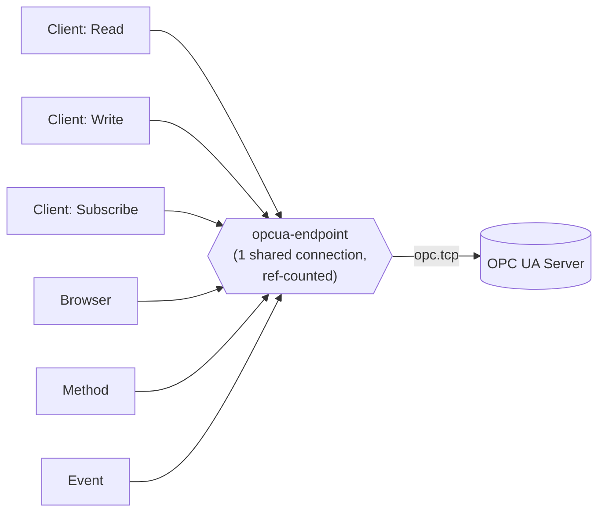
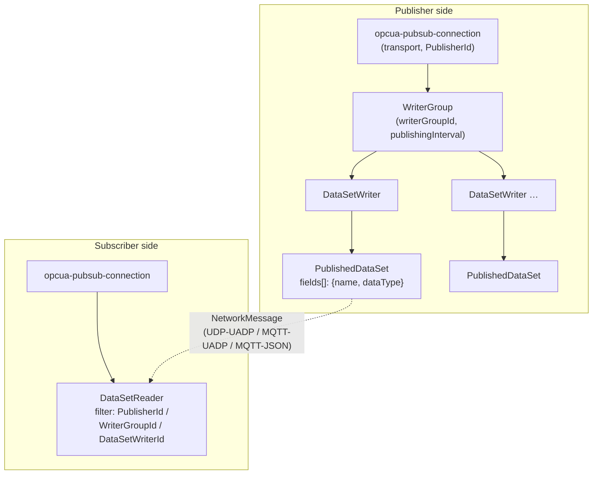
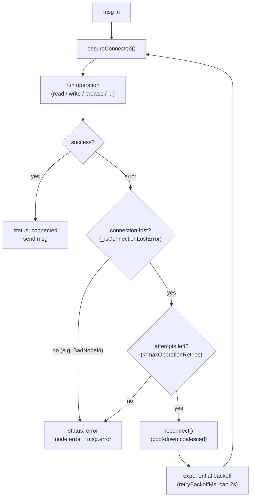
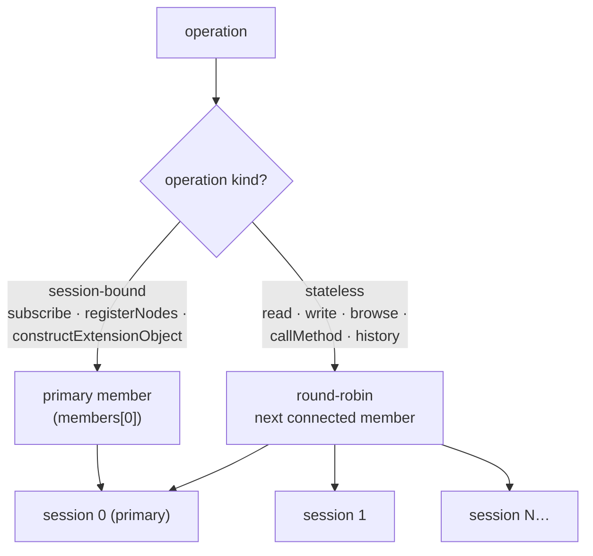

# node-red-contrib-opcua-suite

[](https://github.com/sponsors/blanpa)

An OPC UA suite for Node-RED.

## Features

- **Shared connections** — All nodes referencing the same endpoint share one TCP connection (ref-counted)
- **Batch read/write** — Single OPC UA service call via `msg.items` or payload object
- **Item collector** — Chain `opcua-item` nodes visually for batch operations
- **Drag & drop certificates** — Upload certs directly in the editor UI
- **Reconnect handling** — `keepSessionAlive` + session recovery + connection fallback
- **All-in-one client** — Read, write, subscribe, browse, method, history in one node
- **ExtensionObject support** — Read/write structured types with automatic serialization
- **Discovery** — `getendpoints`, `registernodes`, `translatebrowsepath`
- **Status propagation** — Shared endpoint broadcasts connection state to all nodes
- **OPC UA PubSub** — `opcua-publisher` / `opcua-subscriber` worker nodes over UDP-UADP multicast or MQTT (UADP or JSON), with cyclic/KeepAlive and msg-driven publishing — see [OPC UA PubSub](#opc-ua-pubsub)

## Installation

```bash
cd ~/.node-red
npm install node-red-contrib-opcua-suite
```

## Quick Start

### 1. Read a variable

```
[inject] → [OPC UA Client] → [debug]
```

Set `msg.topic` to a NodeId (e.g. `ns=2;s=Temperature`) in the inject node. Set the client's default operation to **Read**. Done.

### 2. Batch read multiple variables

```
[inject] → [Item: Temp] → [Item: Pressure] → [OPC UA Client] → [debug]
```

Each **OPC UA Item** node adds its variables to `msg.items`. The client reads them all in **one** OPC UA service call. No function node needed.

### 3. Write a value

```
[inject] → [OPC UA Client] → [debug]
```

Set `msg.payload` to the value (e.g. `25.5`) and `msg.topic` to the NodeId in the inject node. Set the client's default operation to **Write**. DataType is auto-detected from the JS type.

### 4. Subscribe to live changes

```
[inject] → [OPC UA Client] → [debug]
```

Set `msg.topic` to the NodeId and the client's default operation to **Subscribe**. Click inject once — every value change on the server produces a new message.

> Import ready-to-use flows from **Menu → Import → Examples → node-red-contrib-opcua-suite**.

## Nodes

All edit dialogs share one layout: short labels, collapsible sections for advanced settings, units next to the field and colours from the editor theme, so they work in light and dark themes. NodeId fields have a **Browse** button that picks the node from a deployed endpoint's address space.

### opcua-endpoint (Config Node)

Shared connection configuration. All nodes referencing the same endpoint share **one** TCP connection (ref-counted: connected on first node, disconnected when the last node closes).



With **Sessions** > 1 the endpoint holds N sessions instead of one — see [Session pool routing](#session-pool-routing).

| Section | Field | Description |
|---|---|---|
| | Endpoint URL | `opc.tcp://localhost:4840`, or an environment variable such as `${OPCUA_URL}` |
| Security | Mode | None, Sign, Sign and encrypt |
| | Policy | Basic256Sha256, Aes128_Sha256_RsaOaep, Aes256_Sha256_RsaPss; Basic256 and Basic128Rsa15 are marked deprecated. Shown only when the mode is not None |
| | Certificates | Optional client certificate, private key and server certificate (drag and drop). Without them a self-signed certificate is created |
| Authentication | Method | Anonymous, Username and password, or User certificate (X509). Only the chosen method is saved |
| Connection behaviour | Connect tries | Retries per connect attempt (default 10) |
| | Reconnect delay | Longest pause between connect retries and start of the background reconnect (default 5000 ms) |
| | Timeout | Per-operation timeout in ms (default 10000). Raise it for slow PLCs — an operation that overruns marks the connection dead and forces a reconnect on the next message. |
| | Sessions | Number of sessions (default 1 = single shared session). `>1` round-robins stateless reads/writes/browse across N sessions; subscriptions & registered nodes stay on the primary. Only helps when a single session is the bottleneck — see [Benchmark](#benchmark--stress-test). |
| | Application | Application name reported to the server |

Connect tries, reconnect delay and application name used to be set on each client node, although only the first node opening the shared connection counted. They now belong to the endpoint. A client node from an older flow still provides them while the endpoint leaves the field empty.

### opcua-client (All-in-One)

Single node for all OPC UA operations. Set via `msg.operation` or the default operation in the node config.

| Operation | msg.topic / msg.nodeId | msg.payload | Description |
|---|---|---|---|
| `read` | NodeId | — | Read a single variable |
| `readmultiple` | — | — | Read all items in `msg.items` |
| `write` | NodeId | Value to write | Write a single variable |
| `writemultiple` | — | — | Write all items in `msg.items` |
| `subscribe` | NodeId | — | Subscribe to value changes |
| `unsubscribe` | NodeId | — | Stop subscription |
| `browse` | NodeId (default: RootFolder) | — | Browse address space |
| `method` | — | Input arguments | Call a method (needs `msg.objectNodeId` + `msg.methodNodeId`) |
| `history` | NodeId | — | Read historical values (needs `msg.startTime` + `msg.endTime`) |
| `getendpoints` | — | — | Discover server endpoints |
| `readattribute` | NodeId | — | Read BrowseName, DisplayName, etc. |
| `registernodes` | — | — | Register nodes for fast access |
| `unregisternodes` | — | — | Release registered nodes |
| `translatebrowsepath` | — | Browse path | Translate browse path to NodeId |

When `msg.items` is present, the client automatically switches to batch mode — even if the operation is set to `read` or `write`.

Every output (including the error output) carries the resolved operation in `msg.operation` — `"read"`, `"write"`, `"browse"`, … (lower-cased), or the more specific `"readmultiple"` / `"writemultiple"` when a batch ran — so a downstream **switch** node can branch on it.

**Resilience**: the client connects on deploy (**Connect on deploy**, default on) so its status reflects the real connection immediately. Under **On connection loss** each message is retried up to **Retries** times (default 3) with exponential **Backoff** (default 100 ms, capped at 2 s) — see [Resilience hardening](#resilience-hardening-implemented). Connect tries and reconnect delay are set on the endpoint.

### opcua-item (Item Collector)

Defines OPC UA items (variables) for batch operations. Each item needs a **NodeId** and optionally a **Name** and **DataType**.

**Chain pattern** — multiple Item nodes in series, each adds to `msg.items`:
```
[inject] → [Item: Temp] → [Item: Pressure] → [Item: Speed] → [Client]
```

**List pattern** — all items in a single node:
```
[inject] → [Item: Temp, Pressure, Speed] → [Client]
```

With **Collect into msg.items** (default), items are appended to `msg.items` for batch operations. With it off, only the first item is set on `msg.topic` / `msg.datatype` for single operations.

**Browse** next to each NodeId picks a variable from a deployed endpoint and fills in an empty name and data type.

**DataType** (per item, write-only) covers the full OPC UA type set: booleans/integers (`Boolean`, `SByte`/`Byte`, `Int16`–`Int64`, `UInt16`–`UInt64`), floating point (`Float`, `Double`), text/time (`String`, `DateTime`, `LocalizedText`, `QualifiedName`, `XmlElement`), binary/identifier types (`ByteString`, `Guid`, `NodeId`, `ExpandedNodeId`, `StatusCode`), the structured `ExtensionObject`, and an *Advanced (rarely writable)* group (`DataValue`, `Variant`, `DiagnosticInfo`, offered for completeness — incompatible values surface a server write error). The DataType is only used for writes — reads always return the server's type. Leave it on **Auto** to let node-opcua infer the type from the JS value.

**Array** — tick the per-item **Array** box to write the value as an array (ValueRank); the payload must be a JS array (e.g. `[1, 2, 3]`). Sets `arrayType: "Array"` on the item (or `msg.arrayType` for a single write).

**ExtensionObject** — selecting `ExtensionObject` reveals an optional **DataType NodeId** field (e.g. `ns=2;i=3003`); leave it empty to take the structure type from the variable. The payload is a plain JSON object of the struct fields, or an array of them. See [ExtensionObjects](#extensionobjects-structured-types).

**Operation** (optional) sets `msg.operation` (read, read multiple, write, write multiple, subscribe, unsubscribe) so the downstream client knows what to do without a separate config — leave on *don't set* to keep the client's default or an existing `msg.operation`.

**Unwrap single value** sets `msg.unwrapSingle = true`. When a read resolves to exactly one item, the client delivers the scalar value in `msg.payload` (e.g. `false`) instead of a one-element array (`[{value:false, …}]`). The same option also exists on the client node; see [Single-value reads](#single-value-reads).

### opcua-browser

Browses the OPC UA address space. Send a NodeId via `msg.topic` to browse from that node, or leave empty to start from the configured **Start node** (default `RootFolder`; **Browse** picks it from the server).

| Input | Description |
|---|---|
| `msg.topic` / `msg.nodeId` | Starting NodeId (default: `RootFolder`) |
| `msg.recursive` | Set to `true` for recursive browsing |

Output: `msg.payload` contains an array of references with `browseName`, `nodeId`, `nodeClass`, and `typeDefinition`.

### opcua-browse-client

Interactive address space browser with an **editor tree view**. Select variables visually in the editor, then read or subscribe to them at runtime. No NodeIds to type — just click.

Modes:
- **Read** — trigger via inject to read all selected items
- **Subscribe** — automatically subscribes on deploy, emits a message per value change

### opcua-method

Calls an OPC UA method. Configure the **Object** and **Method** NodeIds in the node or pass them via `msg.objectNodeId` / `msg.methodNodeId`. **Browse** picks the method from a deployed endpoint and fills in its object; **Read arguments from the server** lists the input and output arguments and shows an example `msg.inputArguments`.

Input arguments via `msg.payload` as an array:
```json
[{"dataType": "Double", "value": 3.14}, {"dataType": "String", "value": "hello"}]
```

Or simple values (datatype auto-detected): `[3.14, "hello", true]`

Output: `msg.payload` = array of return values, `msg.statusCode` = method status.

### opcua-event

Subscribes to OPC UA events and alarms.

| Config | Description |
|---|---|
| Source | Node to monitor (default: `i=2253` — Server node); **Browse** picks it from the server |
| Event type | e.g. `BaseEventType`, `AlarmConditionType`; the field suggests the standard event types |

Send `msg.action = "subscribe"` to start, `msg.action = "unsubscribe"` to stop. Each event produces a message with `eventType`, `severity`, `message`, `time`, and `sourceName`.

### opcua-server

Embedded OPC UA server. Starts automatically on deploy. Build the address space at runtime via `msg.command`:

| Command | Required fields | Description |
|---|---|---|
| `addFolder` | `msg.folderName` | Create a folder in the address space |
| `addVariable` | `msg.variableName`, `msg.datatype` | Add a variable (optional: `msg.initialValue`) |
| `addObject` | `msg.objectName` | Add an object node |
| `addMethod` | `msg.methodName`, `msg.parentNodeId` | Add a callable method under an object node (optional: `msg.inputArguments`, `msg.outputArguments`, `msg.func` — see the security note below) |
| `setValue` | `msg.nodeId`, `msg.payload` | Update a variable's value. `msg.datatype` is optional — the variable's own declared DataType is used when it is absent |
| `setWritable` | `msg.nodeId` | Make a variable writable by clients |
| `deleteNode` | `msg.nodeId` | Remove a node |
| `raiseEvent` | `msg.sourceNodeId`, `msg.message` | Raise an event |
| `getServerInfo` | — | Get session count, endpoint URL, server state |

> **Security — `msg.func`:** `addMethod` can bind a method handler from a
> JavaScript body carried in `msg.func`, which the server evaluates with
> `new Function()`. Unlike a Function node that body arrives with the
> **message**, so any upstream node fed from outside (`http in`, MQTT, …) can
> execute arbitrary code in the Node-RED process. Since 0.2.0 it is **off by
> default** — enable *Allow method code from `msg.func`* under **Security** in
> the node configuration when every path into the node is trusted.

### opcua-pubsub-connection (Config Node)

Shared PubSub transport configuration. Picks the transport (**UDP** multicast or **MQTT**), the PublisherId, and (for MQTT) the broker URL / topic prefix / QoS. The `opcua-publisher` and `opcua-subscriber` nodes reference it and share one ref-counted transport. See [OPC UA PubSub](#opc-ua-pubsub) for the full configuration hierarchy.

### opcua-publisher

Publishes a DataSet over the referenced `opcua-pubsub-connection`. Declares a WriterGroup with one or more DataSetWriters, edited as a form (writer id, DataSet name, fields with data type, optional configuration version) or, with **Edit as JSON**, as the raw array. **Acyclic** (default): each input `msg.payload` field map becomes one NetworkMessage. **Cyclic**: publishes at `PublishingInterval`, sending a KeepAlive when no value changed. See [OPC UA PubSub](#opc-ua-pubsub).

### opcua-subscriber

Receives DataSets over the referenced `opcua-pubsub-connection`. Declares a DataSetReader filtering on PublisherId / WriterGroupId / DataSetWriterId (the PublisherId field suggests the ids of the workspace's PubSub connections), decodes each NetworkMessage, and emits one `msg` per matched DataSetMessage. A ConfigurationVersion mismatch raises a visible `node.error()`. See [OPC UA PubSub](#opc-ua-pubsub) for the full `msg` shape.

## OPC UA PubSub

PubSub adds broker-less (**UDP-UADP** multicast) and broker-mediated (**MQTT**, UADP or JSON) publish/subscribe alongside the Client/Server nodes. The three shipped combinations are **UDP-UADP**, **MQTT-UADP**, and **MQTT-JSON** — there is **no UDP-JSON** combination. Configuration lives on the `opcua-pubsub-connection` config node (transport, multicast group / broker URL, PublisherId); the `opcua-publisher` and `opcua-subscriber` worker nodes reference it.

### Configuration hierarchy



**Publisher** — `opcua-pubsub-connection` → **WriterGroup** → **DataSetWriter** → **PublishedDataSet**:

- One **WriterGroup** per publisher (`writerGroupId`, `publishingInterval`, `priority`, `maxNetworkMessageSize`).
- One or more **DataSetWriters** (edited as a JSON array in the `writers` field), each bound to one **PublishedDataSet**.
- The PublishedDataSet `fields[]` of `{ name, dataType }` (e.g. `{ "name": "Temperature", "dataType": "Double" }`) type the outgoing values.

**Subscriber** — `opcua-pubsub-connection` → **DataSetReader**:

- The DataSetReader filters on **PublisherId** / **WriterGroupId** / **DataSetWriterId** — at least one is required.
- For **MQTT-JSON** filter on `publisherId` (and optionally `dataSetWriterId`): JSON NetworkMessages carry no `groupHeader`, so `writerGroupId` is unavailable.

### Publisher input

`msg.payload` is an object keyed by field name — `{ <fieldName>: <rawValue> }`. Each declared PublishedDataSet field present in the payload becomes a Variant in one keyframe; **missing fields are omitted, never fabricated**. One inbound `msg` produces one outbound NetworkMessage.

- **Acyclic** (default): publishes once per inbound `msg`.
- **Cyclic**: publishes every `publishingInterval` ms, sending a keyframe when values changed and a **KeepAlive** NetworkMessage when nothing changed since the last tick.

### Subscriber output (msg shape)

Per matched DataSetMessage the subscriber emits one `msg`:

| Field | Description |
|---|---|
| `msg.payload` | `{ [fieldName]: value }` — Variant/DataValue wrappers removed |
| `msg.publisherId` | PublisherId of the source connection |
| `msg.writerGroupId` | WriterGroup id (`undefined` for JSON encoding — no groupHeader) |
| `msg.dataSetWriterId` | DataSetWriter id |
| `msg.sequenceNumber` | NetworkMessage sequence number (DataSetMessage fallback for JSON) |
| `msg.timestamp` | `Date` of the DataSetMessage |
| `msg.statusCode` | 16-bit DataSetMessage **status summary** (`0` = Good), i.e. the Part 14 §7.2.4.5.2 Good/Bad/Uncertain summary — **not** a full 32-bit OPC UA StatusCode |
| `msg.encoding` | `"uadp"` or `"json"` |
| `msg.transport` | `"udp"` or `"mqtt"` |
| `msg.topic` | MQTT only — omitted entirely for UDP |

A matched DataSetMessage whose ConfigurationVersion differs from the optional `expectedConfigVersion` raises a visible `node.error()` and is dropped — it is never silently swallowed.

### Encoding rules

The **UDP** transport carries **UADP** binary NetworkMessages only — selecting JSON over a UDP connection is rejected at startup. **MQTT** allows either UADP or JSON. **UDP-JSON is not a shipped combination**. JSON is the cloud-friendly, self-describing choice (each message carries its own field names and types, no metadata pre-exchange).

### UDP multicast NIC selection

The UDP socket always binds to `0.0.0.0`. Leave `multicastInterface` at `0.0.0.0` to let the OS choose the outgoing NIC. On a **multi-NIC host** the OS may pick the wrong interface for multicast — set `multicastInterface` to the host's IP on the PubSub LAN if datagrams are not received. This field only pins the interface used to join the group and send.

### PubSub examples

See example flows **10 - PubSub UDP-UADP Loopback** (self-contained, no external infra), **11 - PubSub MQTT-UADP**, and **12 - PubSub MQTT-JSON**. Flows 11 and 12 require a local MQTT broker at `mqtt://localhost:1883` (e.g. `docker run -p 1883:1883 eclipse-mosquitto`, or `docker compose -f docker-compose.dev.yml up -d`, which publishes one on 1883).

## Reference

See [docs/MSG-SCHEMA.md](docs/MSG-SCHEMA.md) for the full message field reference.

### NodeId Formats

| Format | Example |
|---|---|
| String | `ns=2;s=MyVariable` |
| Numeric | `ns=2;i=1234` |
| GUID | `ns=2;g=550e8400-e29b-...` |
| Short | `i=84`, `s=MyVar` (ns=0) |
| Well-known | `RootFolder`, `ObjectsFolder`, `TypesFolder`, `Server` |

### DataType Auto-Detection

| JS Type | OPC UA DataType |
|---|---|
| `boolean` | Boolean |
| integer `number` | Int32 |
| float `number` | Double |
| `string` | String |
| `Date` | DateTime |

A plain object (or an array of plain objects) in auto mode is resolved from the target variable's DataType: a structure is written as an [ExtensionObject](#extensionobjects-structured-types), a built-in type such as `LocalizedText` as that type.

Explicit override: `msg.datatype = "UInt16"` or in item config. The item node's **DataType** dropdown offers the full OPC UA scalar set (see [opcua-item](#opcua-item-item-collector)); the override applies to writes only. An unknown name (e.g. a typo) is rejected with `Unknown DataType` instead of falling back to auto detection.

### Value formats for writes

Message values are plain JSON, so writes (`write`, `writemultiple`, method input arguments, the server's `addVariable` / `setValue`) convert them to the declared DataType. A value that does not fit is rejected with an error naming the type and the value — it is never written as something else.

| DataType | Accepted JSON values |
|---|---|
| `Boolean` | `true` / `false`, `"true"` / `"false"`, `1` / `0` |
| Integers, `Float`, `Double` | number or numeric string |
| `Int64` / `UInt64` | number, decimal string (`"9007199254740993"`, exact beyond 2^53), BigInt, or the `[high, low]` pair a read returns. An **array** of Int64 needs `arrayType: "Array"` — a two-number array alone is read as `[high, low]` |
| `String`, `XmlElement` | string (numbers and booleans are converted) |
| `DateTime` | `Date`, ISO 8601 string, or epoch milliseconds (an inject node's timestamp) |
| `Guid` | `"72962B91-FA75-4AE6-8D28-B404DC7DAF63"` |
| `ByteString` | `Buffer`, byte array `[104, 105]`, or a **base64** string (plain text is rejected) |
| `NodeId` | `"ns=2;s=Name"`, `"i=2253"`, well-known names such as `"Server"` |
| `ExpandedNodeId` | as NodeId, optionally `nsu=<namespace uri>;` and `svr=<index>;` prefixes |
| `StatusCode` | number or name (`"Good"`) |
| `QualifiedName` | `"2:Name"` or `{ namespaceIndex, name }` |
| `LocalizedText` | string or `{ locale, text }` |
| `Variant` | `{ dataType, value }` — the value carries its own type; without one the type is inferred |
| `ExtensionObject` | plain object of the struct fields, or an array of them — see below |

Arrays (`arrayType: "Array"` or the item's `[]` box) convert every element the same way.

### Single-value reads

A read that resolves to **exactly one item** — one Item node, or a single-entry `msg.items` — returns a one-element array in `msg.payload` by default (`[{value:false, …}]`), because the client treats `msg.items` as a batch read.

Enable **Unwrap single value** on the client node (or set `msg.unwrapSingle = true`, e.g. via the item node's checkbox) to receive the scalar value directly in `msg.payload`, with its metadata (`dataType`, `statusCode`, `nodeId`, `sourceTimestamp`, `serverTimestamp`) flattened onto `msg`. `msg.unwrapSingle` overrides the node setting per message; reads of two or more items are never unwrapped.

### ExtensionObjects (Structured Types)

**Reading:** ExtensionObjects are automatically serialized to plain JSON in `msg.payload`. The `msg.dataType` will be `"ExtensionObject"` with a `_typeName` field.

**Writing:** send the struct fields as a plain JSON object. The structure type is taken from the target variable's DataType, so no further configuration is needed:
```json
{
    "topic": "ns=2;s=MyStructVar",
    "payload": { "temperature": 25.5, "unit": "Celsius" }
}
```

`msg.datatype = "ExtensionObject"` and `msg.dataTypeNodeId` (the DataType definition NodeId, e.g. `ns=2;i=3003`) are still accepted. Set `dataTypeNodeId` when the variable is declared with an abstract type (e.g. `Structure`) and the concrete subtype cannot be derived from it.

- **Nested structures** are written as nested objects, array fields as JSON arrays. Field names may be camelCase or PascalCase; values follow the [value formats](#value-formats-for-writes) (a DateTime field takes an ISO string).
- **Arrays of structures:** send an array of objects (with `arrayType: "Array"` or in auto mode). Previously the array was written as a single empty record although the server answered `Good`.
- **Read, modify, write back:** a value read from the server can be written back unchanged; the `_typeName` fields are ignored.
- **A write replaces the whole structure.** Fields missing from the object are written with their default value (`0`, `""`, `[]`, `1601-01-01`), they are not kept from the server's current value. To change a single field, read the structure first, change the field and write the whole object back.

## Examples
## Examples

Import ready-to-use flows in the Node-RED editor: **Menu → Import → Examples → node-red-contrib-opcua-suite**.

Available examples:
1. **Read Single Variable** — inject → client → debug
2. **Batch Read with Item Collector** — inject → item → item → client → debug
3. **Write a Value** — inject → client → debug
4. **Subscribe to Changes** — inject → client → debug
5. **Browse Address Space** — inject → browser → debug
6. **Event Subscription** — inject → event → debug
7. **Call a Method** — inject → method → debug
8. **Server with Variables** — inject → server → debug
9. **Session Retry Test** — inject → client → debug
10. **PubSub UDP-UADP Loopback** — self-contained, no external infra
11. **PubSub MQTT-UADP** — requires a local MQTT broker
12. **PubSub MQTT-JSON** — requires a local MQTT broker

All examples work **without function nodes**.

Two comprehensive, self-asserting **validation flows** also live in the GitHub repo (not shipped in the npm package — they target the bundled Docker test stack): `13 - PubSub Full Validation` (9 PubSub scenarios: every transport × encoding, multi-writer, cyclic/KeepAlive, chunking, filtering, ConfigurationVersion mismatch) and `14 - Full Suite Validation` (24 tabs exercising **every** node — client read/write/subscribe/browse/method, item collector, browser, browse-client, method, event, embedded server, authentication, plus all PubSub scenarios). Each tab emits a `[VALIDATE] … PASS/FAIL` line.

Run them against the dev stack, which provides everything both flows address — the OPC UA test server as `opcua-server:4840` and an anonymous MQTT broker as `val-mosquitto:1883`:

```bash
docker compose -f docker-compose.dev.yml up -d
# import the flow, deploy, then click every inject node
```

Two tabs are two-step by design: **T5** (cyclic/KeepAlive), **T8** (filtering) and **T9** (ConfigurationVersion) each have a *reset+publish* inject and a *check* inject. Leave the documented **~2 s gap** between them — a KeepAlive cannot arrive before the next publishing interval elapses, and firing the check immediately reports `FAIL - no keepalive` for what is only impatience.

### Function test suite (example 15)

`15 - Function Test Suite` runs **81 functional tests** on its own, one after another, against the node-opcua test server, an embedded `opcua-server` node and an MQTT broker. No clicking is needed: the suite starts 8 s after deploy, and the *Run all tests* inject on the *FT Control* tab starts it again.

| Area | Covered |
|---|---|
| Client read | every scalar type, arrays, structures and structure arrays, Object nodes, `msg.topic` / `msg.nodeId`, readmultiple (items and name map), `unwrapSingle`, unknown, malformed and missing NodeIds |
| Client write | explicit and documented auto DataType, writemultiple (items and object form), arrays, structures, structure arrays, read-only node, missing and unconvertible values |
| Discovery | browse, readattribute, translatebrowsepath, registernodes / unregisternodes, getendpoints |
| Methods, subscriptions, history | typed and payload arguments, wrong argument count, subscribe / unsubscribe, a write seen through a subscription, HistoryRead |
| Other nodes | `opcua-item` (collector, single, write, unwrap), `opcua-browser` (flat, recursive), `opcua-method`, `opcua-browse-client` (read, subscribe), `opcua-event` |
| Embedded server | every command: getServerInfo, getNamespaceIndex, addFolder, addObject, addVariable, setValue, setWritable, addMethod, the `msg.func` gate, raiseEvent, deleteNode |
| Security | username/password (valid and wrong), Sign and SignAndEncrypt with Basic256Sha256, Aes128_Sha256_RsaOaep and Aes256_Sha256_RsaPss |
| PubSub | UDP-UADP, MQTT-UADP, MQTT-JSON, two DataSetWriters, chunking, UInt32 PublisherId, filtering, ConfigurationVersion mismatch, cyclic KeepAlive |
| All nodes at once | the *FT Node Overview* tab lists all 11 node types with the tests using them; test N01 passes one message through all nine flow node types in a row |

The generator refuses to build a flow that leaves a node type of the package unused, and the runner checks the types installed in Node-RED against the deployed flow.

Run it fully automated in Docker. The command builds the stack, deploys the flow, prints one line per test and exits non-zero when a test fails:

```bash
npm run test:functional        # or: make functest
```

Each test reports `PASS` or `FAIL` with the reason in the debug sidebar and in the Node-RED log (`[FT]` lines). `GET /opcua-functest/results` returns the last run as JSON. The flow is generated by `test/functional/build-flow.js`; change the generator and run `npm run test:functional:flow` instead of editing the JSON.

## Docker

```bash
docker compose up -d          # Start Node-RED + OPC UA test server
# Node-RED: http://localhost:1881
# Test server: opc.tcp://localhost:4841

docker compose build --no-cache && docker compose up -d --force-recreate  # Rebuild
```

## Testing

```bash
npm test                       # 932 unit tests (8 pending)
npm run lint                   # ESLint
npm run format:check           # Prettier
npm run test:functional        # 81 function tests in Docker (example 15)
node test/live-integration.js  # 36 live integration tests (requires Docker)
```

`test:functional` uses its own compose project (`docker-compose.test.yml`), so it
does not touch a running dev or plain stack. While it runs, Node-RED is reachable
on **port 1882**. To run the suite again on a stack that is already up:

```bash
docker compose -f docker-compose.test.yml up -d --build opcua-server val-mosquitto node-red
NODE_RED_URL=http://localhost:1882 node test/functional/run.js            # deploy and run
NO_DEPLOY=1 NODE_RED_URL=http://localhost:1882 node test/functional/run.js # run again
docker compose -f docker-compose.test.yml down -v
```

`live-integration.js` drives a running Node-RED over its admin API and the
`/comms` websocket on **port 1880**, so run it against the dev stack
(`docker compose -f docker-compose.dev.yml up -d`), which publishes that port.
The plain stack maps Node-RED to 1881 and the script will not reach it.

## Benchmark & Stress Test

Drives the real `OpcUaClientManager` (the engine behind `opcua-client`) against
the bundled test server and reports throughput, latency percentiles (p50/p95/p99),
and error counts under sustained concurrent load. The test server is started
automatically. Phases:

- **Throughput/latency** — `read` (sequential + concurrent), `readMultiple`, `write`
- **Resilience** — connect/disconnect churn (lifecycle leaks) and reconnect
  under load (forced session loss mid-stream, measures recovery rate)
- **Subscribe stress** — N monitored items @100 ms, counts notifications +
  item/teardown errors

```bash
npm run bench             # full run  (5s/phase, 50 concurrent, 200 sub items)
npm run bench:quick       # short run (1.5s/phase) — CI-friendly
```

Tunable via env vars / flags:

```bash
BENCH_DURATION_MS=10000 BENCH_CONCURRENCY=100 BENCH_SUB_ITEMS=500 npm run bench
BENCH_POOL_SIZE=4 npm run bench   # exercise the opt-in session pool
node test-server/benchmark.js --no-spawn --endpoint opc.tcp://host:4840/UA/TestServer
```

Steady-state phases must be error-free or the run exits non-zero (so it doubles
as a load-soak smoke test). The reconnect phase is a deliberate fault-injection
storm — it passes on recovery rate (≥99%) + final connected state. After the
resilience hardening below it now recovers **100% of ops** from forced session
drops in typical runs.

Indicative numbers on an 8-core dev box (node 20):

| Phase | Throughput | Latency |
|-------|-----------|---------|
| read (sequential) | ~1,100 ops/s | p50 ≈ 0.7 ms |
| read (×50 concurrent) | ~6,500 ops/s | p50 ≈ 6 ms, p99 ≈ 20 ms |
| readMultiple (7/call) | ~5,000 ops/s | ≈ 35k values/s |
| write (×50 concurrent) | ~5,500 ops/s | p50 ≈ 7 ms |
| connect/disconnect churn | — | ~60 ms/cycle |
| reconnect under load (4 forced drops) | recovers | 100% ops ok, 0 errors |
| subscribe (200 items) | 127 notif/s | 0 errors |

### Resilience hardening (implemented)

The reconnect-under-load benchmark originally surfaced ~0.2% unrecovered ops
during a forced session-loss storm. The operation path now retries cleanly:



Three fixes:

- **Bounded operation retry** (`opcua-client` node). A connection-lost operation
  is now retried up to `maxOperationRetries` times (default 3) with exponential
  backoff (`retryBackoffMs`, capped at 2 s) instead of exactly once — so a
  second drop landing during the first reconnect no longer fails the message.
- **Reconnect cool-down** (`OpcUaClientManager`). After a successful reconnect,
  a redundant `reconnect()` arriving within `reconnectCooldownMs` (default
  250 ms) while still connected is a no-op, removing the race where a burst of
  callers each forced another teardown+connect that briefly flipped
  `isConnected` to false under other in-flight operations.
- **Wider connection-lost classification.** `_isConnectionLostError()` now also
  recognises the channel-teardown abort ("Transaction has been canceled because
  client channel is being closed") and `BadSessionClosed` / `BadSessionIdInvalid`
  / `BadConnectionClosed` / `BadSecureChannelClosed` status errors, so those are
  retried rather than surfaced as failures.

- **Optional session pool** (implemented, opt-in). The endpoint config node has
  a **Session Pool** field (default 1 = single shared session, unchanged). With
  `poolSize > 1`, stateless operations (read/write/browse/...) round-robin across
  N sessions; session-bound operations (subscriptions, registered nodes) stay on
  the primary member. A pool only raises throughput when a single session/channel
  is genuinely the bottleneck (high-latency links, servers that serialize per
  session) — on a local low-latency server the server/CPU is the limit, so a pool
  shows no gain there. Default behaviour is byte-for-byte unchanged at `poolSize 1`.

#### Session pool routing



Session-bound work keeps its session affinity on the primary; stateless work
spreads across all connected sessions. If no member is connected, the call
falls through to the primary so the retry/reconnect path above kicks in.

### Further ideas

- **`readMultiple` is the throughput win.** One batch call returns ~7× the values
  of a single read at similar latency — prefer it (or subscriptions) over many
  single `read` ops in hot flows.

## Sponsor this project

This package is developed and maintained in my own time.
If it saves you some, consider supporting it:

<a href="https://github.com/sponsors/blanpa">
  
</a>
<a href="https://buymeacoffee.com/blanpa">
  
</a>

## License

Apache License 2.0 — see [LICENSE](LICENSE) and [NOTICE](NOTICE).

Copyright 2026 blanpa

## Contributing and forks

Pull requests are welcome, including large ones. If you are planning a bigger
change — a dependency migration, a restructure, new nodes — please open an issue
first. We are happy to discuss it and to land substantial work here; that is
usually less effort than maintaining a parallel package, and it keeps a single
place for users to report bugs.

If you do publish a fork under its own package name, please also rename the
Node-RED node type IDs (for example `myprefix-opcua-suite-*`) and use your own palette
category. Node-RED refuses to register a node type that is already claimed, so
identical type IDs make it impossible to install both packages side by side.

